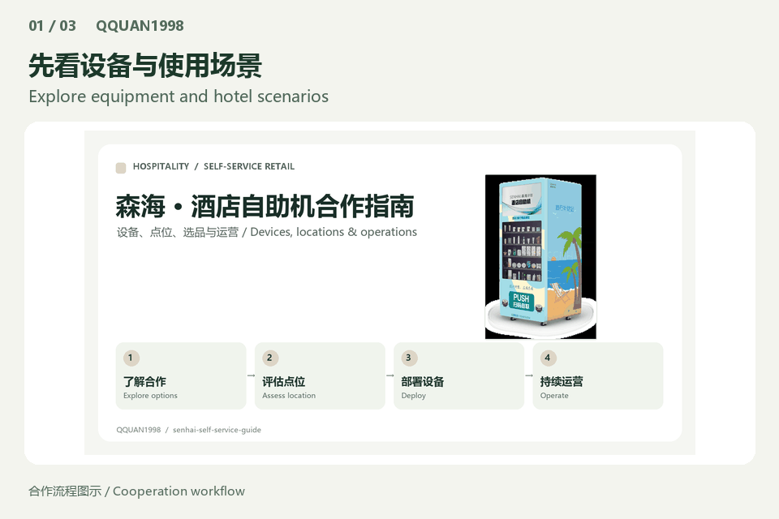
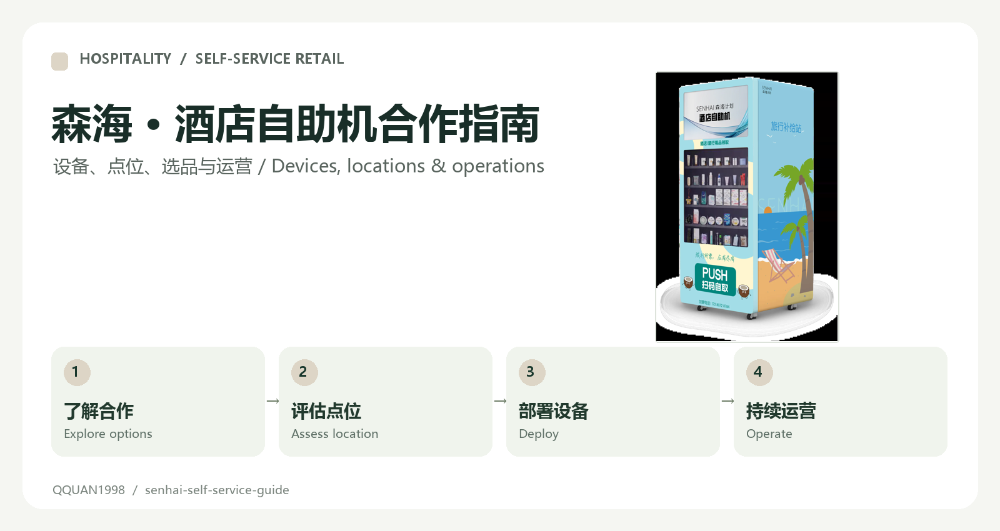
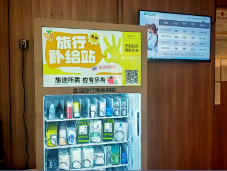

# A visual guide to hotel self-service retail

[简体中文](README.md) · [Visual tour](https://qquan1998.github.io/senhai-self-service-guide/docs/demo.html) · [Report an issue](https://github.com/QQUAN1998/senhai-self-service-guide/issues)



> For hotel operations, cooperation discussions and deployment planning. Open http://localhost:8080 locally. Financial examples are scenario assumptions, not return promises. The full guide is in Chinese.

<a id="quick-start"></a>

## Quick start

1. Open the complete online guide without installation or sign-in.
2. Browse the service system, cooperation models and deployment sections.
3. To edit locally, clone the repository and run the command below from its root.

```text
python -m http.server 8080
```

[Bilingual launch copy](docs/LAUNCH.md) · [Documentation changes](docs/UPDATES.md) · [Release checklist](docs/RELEASING.md)

---

# Senhai · Hotel Self-Service Partnership Guide

[简体中文](README.md) · [View the guide source](index.html)



A responsive HTML service guide for explaining hotel self-service retail equipment, partnership options, site requirements and ongoing operations.

## Inside the guide

| Section | What it explains |
| --- | --- |
| Service model | Guest services, retail, supply chain and possible extensions |
| Partnership options | Three A/B/C arrangements and illustrative scale calculations |
| Benefits | Guest convenience, front-desk workload and operating responsibilities |
| Deployment | Suitable locations, implementation steps and equipment overview |
| Gallery | Existing machine designs and hotel-site imagery |



## View locally

```sh
python -m http.server 8080
```

Open `http://localhost:8080`. Keep `index.html` beside the `assets` directory when sharing or hosting. The source page is in Chinese; this English README explains the project and does not claim the page UI has been translated.

## Project structure

- `index.html`: responsive page, interactive scale illustration and gallery.
- `assets/`: equipment, hotel-scene, logo and partner imagery already included in this repository.
- `docs/images/overview.png`: bilingual project and process overview.

Revenue figures in the page are scenario illustrations based on stated assumptions, not audited returns or a guaranteed outcome. Equipment funding and advertising performance require separate assessment. Brand marks and site imagery retain their respective rights; public source visibility is not a blanket reuse license.
