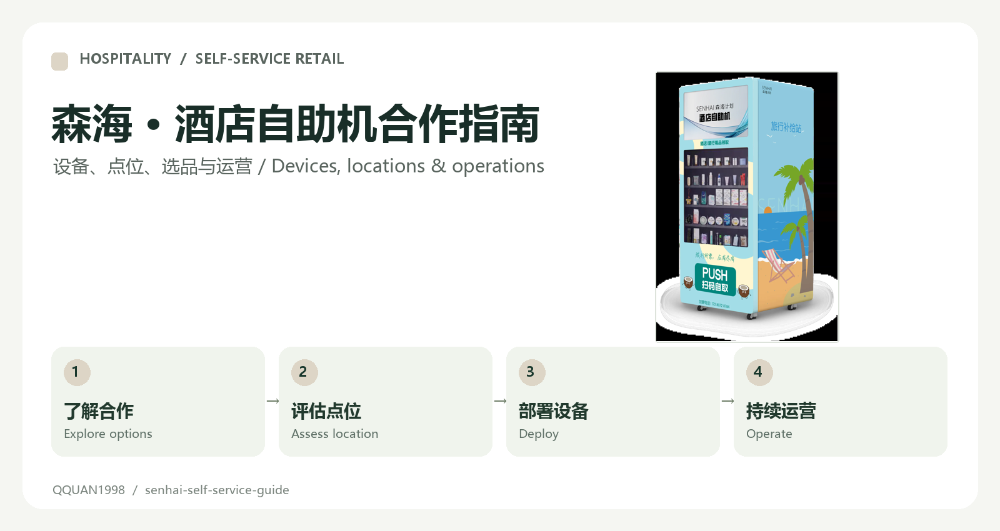
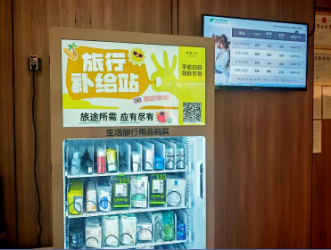

# 森海 · 酒店自助机合作服务指南

[English](README.en.md) · [页面源码](index.html)



一个适合电脑与手机阅读的 HTML 合作指南，用图示说明酒店自助机设备、合作方式、点位条件与持续运营。

## 页面包含什么

| 模块 | 说明 |
| --- | --- |
| 服务体系 | 住客服务、零售、供应链与后续延展 |
| 合作方案 | A/B/C 三种合作方式及规模测算示例 |
| 酒店价值 | 住客便利、前台减负和双方运营职责 |
| 点位部署 | 适配点位、落地步骤和设备能力 |
| 实拍画廊 | 现有设备外观与酒店场景图片 |



## 本地查看

```sh
python -m http.server 8080
```

浏览器打开 `http://localhost:8080`。转发或部署时保留 `index.html` 和相邻 `assets` 目录。现有页面正文为中文，英文 README 仅提供项目说明。

## 目录

- `index.html`：响应式页面、规模收益演示及图片画廊。
- `assets/`：仓库已有的设备、酒店场景、品牌标识与合作酒店图片。
- `docs/images/overview.png`：新增的中英文项目与流程概览图。

页面收益数字是按假设进行的场景演示，不是经审计业绩或收益承诺；设备出资与广告效果需分别评估。品牌标识和场景图片保留原有权利，仓库公开不等于授予全部素材的任意使用许可。
